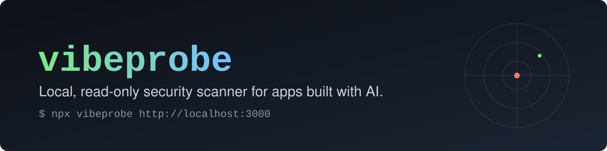
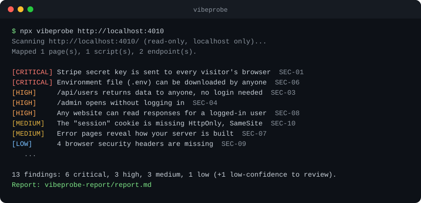
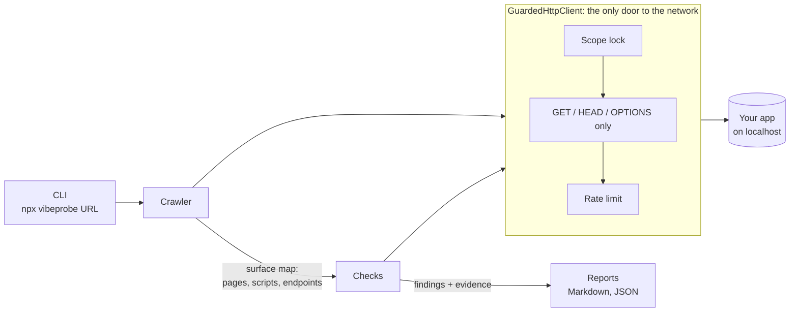

<p align="center">
  
</p>

<p align="center">
  <a href="https://github.com/januarsyah901/vibeprobe/actions/workflows/ci.yml"></a>
  <a href="LICENSE"></a>
  
  <a href="https://www.npmjs.com/package/vibeprobe"></a>
  
  <a href="CONTRIBUTING.md"></a>
</p>

**vibeprobe tests the app you are building, while it runs, the way an attacker would, but read-only and only against apps you own.** It finds the holes AI-written apps tend to ship with, explains each one in plain language, and gives you a **fix prompt** to paste into Cursor, Claude Code, Lovable or Bolt.

<p align="center">
  
</p>

## Why

Most security tooling for AI-built apps *reads your code*. That misses what only shows up at runtime: a database table anyone can read, a secret key that shipped to the browser, an admin page with no login.

General scanners such as OWASP ZAP and Nuclei can find these too, but they are built for security people: lots of configuration, technical reports. vibeprobe is built for the person who just shipped a feature with an AI assistant and wants to know *is this safe to share?*

- **Zero config.** One command, no files to write.
- **Plain language.** Every finding says why it matters in two sentences.
- **Proof, not guesses.** Each finding has evidence, a confidence level, and a read-only `curl` to reproduce it.
- **Fix prompts.** Every finding comes with a ready-to-paste prompt for your AI coding tool.
- **Accurate before broad.** A check ships only with a vulnerable fixture it must catch *and* a safe fixture where it must stay silent.
- **100% local.** No telemetry. Nothing leaves your machine except requests to your own app.

## Quick start

> **The npm release is pending.** Until `npx vibeprobe` works, use the from-source steps below.

Requires Node.js 22.18+. Start your app, then in another terminal:

```bash
npx vibeprobe http://localhost:3000
```

Want to see it find something first? Run the deliberately vulnerable demo app from source:

```bash
git clone https://github.com/januarsyah901/vibeprobe.git && cd vibeprobe
npm install && npm run build
node fixtures/vulnerable-app/server.ts &   # http://localhost:4010 (insecure on purpose, localhost only)
node packages/cli/dist/bin.js http://localhost:4010
```

Reports are written to `./vibeprobe-report/`: an offline `report.html` (open it in a browser), plus `report.md` and `report.json`. The HTML report is one self-contained file with no external requests, a "Fix these first" section, and a copy button on every fix prompt. Low-confidence findings are listed separately under *Needs a human look* and never fail a run.

Fixed something? Re-run just that check:

```bash
npx vibeprobe http://localhost:3000 --recheck SEC-01
```

The exit code is `0` when clean, `1` when there are findings, `2` for bad input or an out-of-scope target, so it already works in CI.

## What it checks

| ID | Check | Severity | Status |
| --- | --- | --- | --- |
| SEC-01 | Secrets in the JavaScript bundle (Stripe, AWS, GitHub, Slack, private keys, Supabase `service_role`) | Critical | ✅ done |
| SEC-02 | Open database: Supabase tables without RLS, open Firebase rules | Critical | 🛠 planned |
| SEC-03 | API endpoints that answer without authentication | High | ✅ done |
| SEC-04 | Admin pages without protection | High | ✅ done |
| SEC-05 | IDOR: change an ID, see someone else's data (two test accounts) | High | 🛠 planned |
| SEC-06 | Exposed `.env`, `.git/` and backup files | Critical | ✅ done |
| SEC-07 | Debug mode and stack traces in production | Medium | ✅ done |
| SEC-08 | CORS that reflects any origin with credentials | High | ✅ done |
| SEC-09 | Missing security headers | Low | ✅ done |
| SEC-10 | Session cookies without `Secure` / `HttpOnly` / `SameSite` | Medium | ✅ done |
| SEC-11 | Source maps exposed in production | Medium | ✅ done |

A Supabase **anon** key is public by design and is never reported. Endpoints that are public on purpose (like `/api/products`) are not flagged; SEC-03 is high confidence only when the response holds personal-data fields. vibeprobe detects dev servers and skips production-only checks there, so `npm run dev` does not drown you in noise.

## How it works



Everything that talks to the network goes through `GuardedHttpClient`, and a lint rule forbids network calls anywhere else. Read [docs/architecture.md](docs/architecture.md) for details.

## Safety rules, enforced in code

These are not just promises in a README. Each one has automated tests.

- **Your apps only.** By default vibeprobe only talks to `localhost`, `127.0.0.1`, `[::1]` and `*.localhost`. Anything else is refused before a packet is sent.
- **No escaping the scope.** Every redirect hop is re-checked. Hostnames are resolved and the resulting IP is validated at connect time, so DNS rebinding cannot aim the scanner at an internal network or a cloud metadata address.
- **Read-only.** Only `GET`, `HEAD` and `OPTIONS` are sent. Other methods are blocked inside the HTTP client.
- **Gentle.** 5 requests per second by default, with backoff on `429` and `503`.
- **Private.** No telemetry. Secrets in reports are masked down to a few leading characters.

**Do not use vibeprobe against systems you do not own or do not have written permission to test.** See [SECURITY.md](SECURITY.md) to report a vulnerability in vibeprobe itself.

## Example finding

```text
[CRITICAL] Environment file (.env) can be downloaded by anyone (SEC-06, confidence high)

Why: The file holds your passwords and API keys, and the web server hands it to anyone who asks.

Evidence:  GET http://localhost:4010/.env  ->  200
           DATABASE_URL=po************
           STRIPE_SECRET=sk************

Reproduce: curl -sS -i 'http://localhost:4010/.env'

Fix prompt (paste into your AI coding tool):
  The file /.env is publicly downloadable from this app. Please:
  1. Make sure the web server only serves a dedicated public folder ...
  2. Add a rule that blocks requests for dotfiles ...
  3. Treat every value in that file as leaked: rotate all keys and passwords.
```

Fix prompts are filled from templates, not by an LLM, so they are consistent and testable.

## Roadmap

- [x] Scope lock, DNS-rebinding protection, read-only HTTP client, rate limiter
- [x] Crawler, check engine, zod-validated findings
- [x] SEC-01, 03, 04, 06, 07, 08, 09, 10, 11 with vulnerable + safe fixtures
- [x] HTML, Markdown and JSON reports
- [x] `--recheck <ID>`: re-run one check after you fix it
- [x] SEC-03, 04, 07, 10
- [ ] SEC-02: Supabase / Firebase open database (asks before touching third-party hosts)
- [x] Self-contained HTML report
- [ ] Playwright crawler for single-page apps
- [ ] `--fail-on`, baseline file and GitHub Action for CI
- [ ] SARIF output for the GitHub Security tab
- [ ] Two-account scan for IDOR (SEC-05)
- [x] Publish to npm

Ideas and votes live in [issues](https://github.com/januarsyah901/vibeprobe/issues); look for **good first issue**.

## Contributing

The easiest first contribution is **a new check**. A check is one small file plus two fixtures. [docs/writing-a-check.md](docs/writing-a-check.md) walks through it in about 10 minutes. See [CONTRIBUTING.md](CONTRIBUTING.md) for the ground rules and [CODE_OF_CONDUCT.md](CODE_OF_CONDUCT.md).

```bash
npm install
npm test          # vitest
npm run typecheck
npm run lint
npm run build
```

## License

[MIT](LICENSE) © vibeprobe contributors
