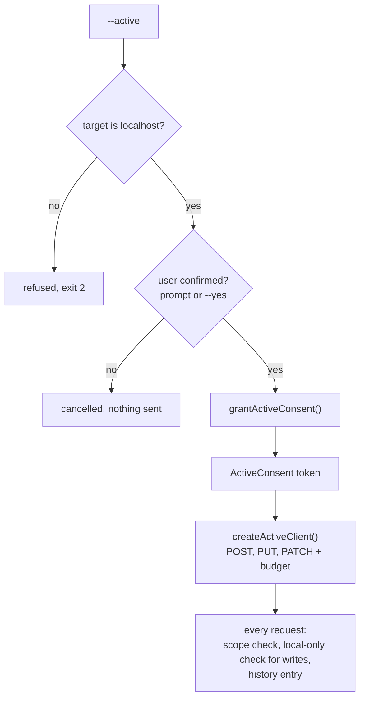

# Active mode: design

vibeprobe's default scan is read-only. **Active mode** (`--active`) adds checks that must send something to be sure: a marker for XSS, a quote for SQL injection, an empty body to a write endpoint. This page explains how it stays safe enough for someone who has never run a security tool.

## The rule

> Active mode only ever talks to localhost, only after you said yes, and it tells you everything it sent.

Everything below exists to make that sentence true in code, not just in the README.

## Layers

1. **The CLI** refuses a non-local target before doing anything (exit code 2).
2. **`grantActiveConsent()`** is the only way to make an `ActiveConsent`. It throws unless `acknowledged` is true and the host is local. The class constructor needs a module-private symbol, so nothing else can build one.
3. **`GuardedHttpClient`** will not even be constructed with a write method unless it receives a real `ActiveConsent`. It refuses `DELETE` outright, in every mode.
4. **Per request**, a write method is checked again: the host must be local, even if the scope would allow it. Writes never follow redirects and are never retried (retrying a `POST` could create the same record twice).
5. **Budget.** `createActiveClient()` caps a scan at 1,500 requests.
6. **Audit trail.** The client keeps a history of every request (method, URL, status, which check sent it). The HTML, Markdown and JSON reports include it.

Passive checks keep using the read-only client. Only the active checks get the active client, and only after the passive run is finished.

## `--plan`

`--plan` builds the same active client in dry-run mode. Checks run normally, but every request is recorded instead of sent, so you see exactly what a real run would do. The initial page crawl is real (it is read-only and needed to find inputs). Because dry-run answers have status `0`, plan mode shows the requests but never findings.

## What each check sends

| Check | Request | Why it is safe |
| --- | --- | --- |
| ACT-01 XSS | `GET ?q="'<vpab12cd34>` | A made-up tag. It is looked for in the reply. |
| ACT-02 SQLi | `GET ?id=test'` | One quote. Only the error text is looked for. |
| ACT-03 CSRF | `POST` with a foreign `Origin`, body `vibeprobe=csrf-test` | Only runs when the cookie has no SameSite flag. |
| ACT-04 Traversal | `GET ?file=../../../../etc/passwd` | Read-only. |
| ACT-05 Attempt limit | 12 × `POST` login with wrong credentials | Not a guess list: the same obviously wrong login. Stops at the first 429. |
| ACT-06 Write w/o login | `POST` `{}` | Empty body. A 2xx may leave an empty record. |
| ACT-07 Mass assignment | `POST` `{name, email, role: "admin", ...}` with marker values | May create a record with marker values. |
| ACT-08 NoSQLi | `POST` login with `{"$ne": null}` | Compared with a wrong-password baseline. Changes nothing. |
| ACT-09 SSTI | `GET ?name={{1337*7331}} ${…} <%= … %> #{…}` | The answer `9801547` never appears by accident. |
| ACT-10 SSRF | `GET ?url=http://127.0.0.1:<port>/vp-ssrf/<token>` | The URL points at a listener inside vibeprobe. Nothing outside your machine is contacted. |
| ACT-11 Host header | `GET` with `Host` and `X-Forwarded-Host` set to a made-up name | Read-only. |
| ACT-12 Hidden routes | `GET` of about 25 common paths | Read-only. |
| ACT-13 Prototype pollution | `POST {"__proto__": {"vpPolluted": "<marker>"}}` | Only touches in-memory objects of the app. A restart clears it. |

## What is deliberately left out

- **Password or credential guessing.** ACT-05 sends one obviously wrong login 12 times. There is no wordlist and no default-credentials check.
- **Command injection, file upload, request smuggling, race conditions.** These can hurt a running app or the machine under it.
- **Anything that destroys data.** No `DELETE`, no `DROP`, no destructive SQL.
- **Denial of service.** The rate limit (default 5 requests per second) and the request budget apply to active mode too.

## False positives

Every active check has to pass the same fixture rule as the passive ones: it must find its hole in `fixtures/vulnerable-app` and report nothing in `fixtures/safe-app`. Medium-confidence findings (for example ACT-03, ACT-05) are heuristics and say so; a check that cannot prove its claim uses confidence `medium` or `low`.

## Adding an active check

Put it in `packages/checks/src/active/`, set `mode: 'active'` and an `intensity` (`light` or `full`), register it in `activeChecks`, and add a hole to the vulnerable fixture and a safe version to the safe fixture. Use the helpers in `util.ts` (`injectionPoints`, `sendInput`, `sendJson`, `protectedWrites`). Never import a network module: the lint rule forbids it, and the client you receive in `ctx.client` is already guarded.
