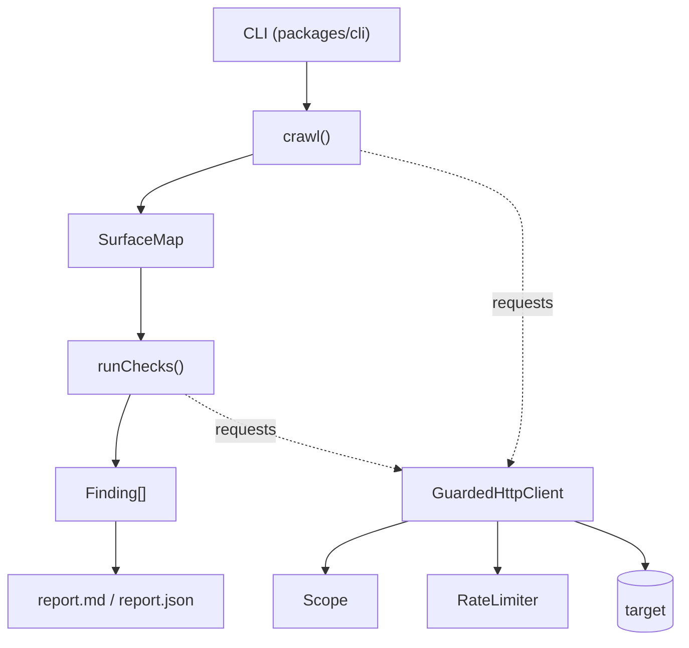

# Architecture

vibeprobe is a small pipeline. Each stage has one job and a typed hand-off to the next.

| Package | Responsibility |
| --- | --- |
| `packages/core` | `Scope`, `GuardedHttpClient`, `RateLimiter`, crawler, `Check` interface and runner, `Finding` schema, secret masking |
| `packages/checks` | One file per check (`secNN-name.ts`) |
| `packages/cli` | Argument parsing, orchestration, report writing. Published as `vibeprobe` |
| `fixtures/` | A deliberately vulnerable app and a safe app used by tests and demos |

## The guarded client

`GuardedHttpClient` is the **only** code allowed to touch the network. It refuses, before sending anything:

1. methods outside the allowed set (default `GET`, `HEAD`, `OPTIONS`);
2. URLs outside the scope, **on every redirect hop** (redirects are followed manually);
3. hostnames that resolve to an address the scope forbids. The check runs inside the connect-time DNS lookup, so the address that is validated is the address that is used. That is what stops DNS rebinding.

It also applies a token-bucket rate limit, backs off on `429` / `503`, enforces a per-request timeout, and caps response bodies.

A lint rule (`no-restricted-imports`, `no-restricted-globals`) forbids `fetch`, `undici`, `node:http` and friends everywhere else. A check literally cannot bypass the guard without failing CI.

## Findings

A `Finding` is validated with zod. Required fields: check id, title, severity, **confidence**, URL, a short *why*, evidence (already masked), a read-only `curl` to reproduce, and a fix prompt.

Confidence is `high` only with direct proof (for example a `200` response containing the data). Pattern-only guesses are `low`.

## Dev servers

The crawler detects dev servers (Vite HMR client, Next.js dev overlay). Checks that only make sense for a production build, such as source maps, skip dev servers instead of reporting noise.
